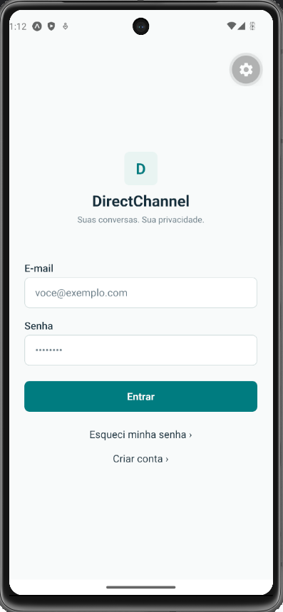
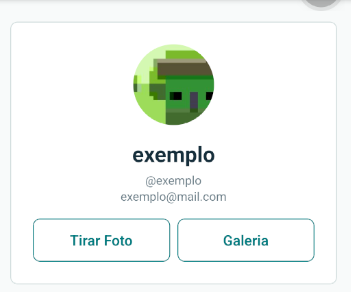
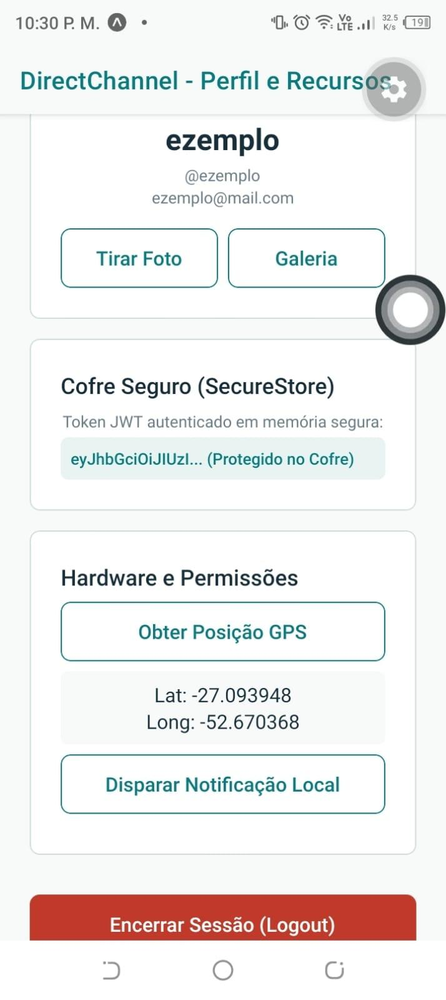

<a id="readme-top"></a>

<!-- PROJECT SHIELDS -->
[![Contributors][contributors-shield]][contributors-url]
[![Forks][forks-shield]][forks-url]
[![Stargazers][stars-shield]][stars-url]
[![Issues][issues-shield]][issues-url]

<!-- PROJECT LOGO -->
<br />
<div align="center">
  <h1 align="center">DirectChannel</h1>

  <p align="center">
    Mensageria mobile com criptografia de ponta a ponta desde o MVP.
    <br />
    <a href="docs/"><strong>Explore a documentação »</strong></a>
    <br />
    <br />
    <a href="docs/directchannel-projeto-ux-ui.pdf">Projeto UX/UI</a>
    &middot;
    <a href="docs/FLUXO-TELAS.md">Fluxo das telas</a>
    &middot;
    <a href="https://github.com/JonathanBufon/directchannel/issues">Reportar problema</a>
  </p>
</div>

<!-- TABLE OF CONTENTS -->
<details>
  <summary>Sumário</summary>
  <ol>
    <li>
      <a href="#sobre-o-projeto">Sobre o projeto</a>
      <ul>
        <li><a href="#tecnologias">Tecnologias</a></li>
      </ul>
    </li>
    <li>
      <a href="#primeiros-passos">Primeiros passos</a>
      <ul>
        <li><a href="#pré-requisitos">Pré-requisitos</a></li>
        <li><a href="#instalação">Instalação</a></li>
      </ul>
    </li>
    <li><a href="#uso">Uso</a></li>
    <li><a href="#documentação">Documentação</a></li>
    <li><a href="#roadmap">Roadmap</a></li>
    <li><a href="#contribuindo">Contribuindo</a></li>
    <li><a href="#equipe">Equipe</a></li>
    <li><a href="#agradecimentos">Agradecimentos</a></li>
  </ol>
</details>

<!-- ABOUT THE PROJECT -->
## Sobre o projeto

<p align="center">
  
  
  
</p>

O DirectChannel é um aplicativo de mensageria para pessoas e pequenos grupos que priorizam a
privacidade das conversas e dos arquivos. O conteúdo é cifrado antes de sair do dispositivo;
servidor e administrador não possuem chaves de leitura.

| Perfil | O que faz | Limite de acesso |
|---|---|---|
| Usuário comum | Conta, pesquisa, conversas, arquivos, grupos, privacidade, bloqueio e denúncia | Somente conversas e arquivos autorizados |
| Responsável pelo grupo | Cria grupo, altera nome, adiciona e remove participantes | Somente seu grupo |
| Administrador | Contas, bloqueios administrativos, denúncias e configurações | Não lê mensagens, anexos ou histórico |

Projeto da disciplina **Desenvolvimento para Dispositivos Móveis** — Turma AX.

<p align="right">(<a href="#readme-top">voltar ao topo</a>)</p>

### Tecnologias

[![React Native][ReactNative-badge]][ReactNative-url]
[![Expo][Expo-badge]][Expo-url]
[![TypeScript][TypeScript-badge]][TypeScript-url]
[![Laravel][Laravel-badge]][Laravel-url]
[![PostgreSQL][PostgreSQL-badge]][PostgreSQL-url]
[![Docker][Docker-badge]][Docker-url]

<p align="right">(<a href="#readme-top">voltar ao topo</a>)</p>

<!-- GETTING STARTED -->
## Primeiros passos

### Pré-requisitos

- Docker com Compose V2
- GNU Make
- Node.js LTS e npm
- App **Expo Go** no celular (ou emulador Android/iOS)

### Instalação

1. Clone o repositório
   ```sh
   git clone https://github.com/JonathanBufon/directchannel.git
   cd directchannel
   ```
2. Suba o backend (cria os `.env`, constrói a imagem, instala dependências, gera a `APP_KEY` e roda as migrations)
   ```sh
   make dev
   ```
3. Inicie o app mobile
   ```sh
   make mobile
   ```

A API sobe em `http://localhost:8010` (porta configurável por `API_PORT` em `infra/.env`).
Passo a passo manual em [docs/SETUP.md](docs/SETUP.md).

<p align="right">(<a href="#readme-top">voltar ao topo</a>)</p>

<!-- USAGE -->
## Uso

| Comando | Ação |
|---|---|
| `make dev` | Prepara (se preciso), sobe API + banco e roda migrations |
| `make mobile` | Inicia o Expo |
| `make logs` / `make ps` | Logs e estado dos containers |
| `make test` | Testes do backend |
| `make artisan c="route:list"` | Qualquer comando artisan |
| `make down` | Para os containers |
| `make help` | Lista todos os comandos |

<p align="right">(<a href="#readme-top">voltar ao topo</a>)</p>

<!-- DOCS -->
## Documentação

| Documento | Conteúdo |
|---|---|
| [Projeto UX/UI (PDF)](docs/directchannel-projeto-ux-ui.pdf) | Escopo, perfis, wireframes, protótipo e requisitos RF01–RF27 / RNF01–RNF20 |
| [Fluxo das telas](docs/FLUXO-TELAS.md) | Índice T01–T24 / A01–A06, diagramas de navegação e pendências |
| [Implementação e evidências](docs/IMPLEMENTACAO.md) | Login, perfil, armazenamento seguro, câmera, GPS e notificações ([relatório PDF](docs/relatorio-tecnico-implementacao.pdf)) |
| [Ajustes de requisitos](docs/REQUISITOS-AJUSTES.md) | Proposta RF28–RF30 e revisão de RNF |
| [Planejamento P01–P12](docs/PLANEJAMENTO.md) | Tarefas da fase UX/UI, responsáveis e revisores |
| [Arquitetura](docs/ARQUITETURA.md) | Camadas mobile/API, persistência, tempo real e modelo de dados |
| [Postman](docs/postman/README.md) | Collection completa da API, ambiente local e execução no Runner |
| [CRUDs](docs/CRUDS.md) | Divisão dos 6 CRUDs e contratos REST |
| [Instalação manual](docs/SETUP.md) | Ambiente sem Makefile e notas de segurança |
| [Colaboração no GitHub](docs/GITHUB.md) | Branches e Pull Requests |
| [Mobile](mobile/readme.md) · [Infra](infra/README.md) | Detalhes de cada módulo |

```text
directchannel/
├── backend/   # API Laravel
├── mobile/    # App Expo + TypeScript (Atomic Design)
├── infra/     # compose.yaml, .env.example, scripts
├── docs/      # documentação e evidências
└── Makefile   # automação do ambiente de desenvolvimento
```

<p align="right">(<a href="#readme-top">voltar ao topo</a>)</p>

<!-- ROADMAP -->
## Roadmap

- [x] Especificação UX/UI, requisitos e protótipo navegável (P01–P12)
- [x] Mobile: login T01 com validação e sessão persistente
- [x] Mobile: perfil T16 com cofre seguro, câmera, GPS e notificações locais
- [x] Backend Laravel + PostgreSQL em Docker
- [ ] Autenticação na API com Sanctum
- [ ] CRUDs: Usuários, Conversas, Mensagens, Grupos, Arquivos, Denúncias
- [ ] Mensagens em tempo real (Laravel Reverb / WebSocket)
- [ ] Criptografia de ponta a ponta
- [ ] Painel administrativo A01–A06

Veja as [issues abertas](https://github.com/JonathanBufon/directchannel/issues) para a lista completa.

<p align="right">(<a href="#readme-top">voltar ao topo</a>)</p>

<!-- CONTRIBUTING -->
## Contribuindo

1. Crie uma branch a partir da `main` (`git checkout -b feat/users-crud`)
2. Faça commits pequenos e descritivos
3. Envie a branch (`git push origin feat/users-crud`)
4. Abra um Pull Request com revisão de outro integrante

Convenções de branches e divisão do trabalho em [docs/GITHUB.md](docs/GITHUB.md) e [docs/CRUDS.md](docs/CRUDS.md).
Quadro de tarefas: [GitHub Projects](https://github.com/users/JonathanBufon/projects/2).

<p align="right">(<a href="#readme-top">voltar ao topo</a>)</p>

<!-- TEAM -->
## Equipe

| Integrante | GitHub |
|---|---|
| Jonathan Bufon | [JonathanBufon](https://github.com/JonathanBufon) |
| Rafael Merisio Neto | [Rafaelmerisioneto](https://github.com/Rafaelmerisioneto) |
| Jaider Armando Marquina Miranda | [Z3ro-0ne](https://github.com/Z3ro-0ne) |

Link do projeto: [github.com/JonathanBufon/directchannel](https://github.com/JonathanBufon/directchannel)

<p align="right">(<a href="#readme-top">voltar ao topo</a>)</p>

<!-- ACKNOWLEDGMENTS -->
## Agradecimentos

- [Best-README-Template](https://github.com/othneildrew/Best-README-Template)
- [Expo](https://docs.expo.dev/)
- [Laravel](https://laravel.com/docs)
- [Shields.io](https://shields.io)

<p align="right">(<a href="#readme-top">voltar ao topo</a>)</p>

<!-- MARKDOWN LINKS & IMAGES -->
[contributors-shield]: https://img.shields.io/github/contributors/JonathanBufon/directchannel.svg?style=for-the-badge
[contributors-url]: https://github.com/JonathanBufon/directchannel/graphs/contributors
[forks-shield]: https://img.shields.io/github/forks/JonathanBufon/directchannel.svg?style=for-the-badge
[forks-url]: https://github.com/JonathanBufon/directchannel/network/members
[stars-shield]: https://img.shields.io/github/stars/JonathanBufon/directchannel.svg?style=for-the-badge
[stars-url]: https://github.com/JonathanBufon/directchannel/stargazers
[issues-shield]: https://img.shields.io/github/issues/JonathanBufon/directchannel.svg?style=for-the-badge
[issues-url]: https://github.com/JonathanBufon/directchannel/issues
[ReactNative-badge]: https://img.shields.io/badge/React_Native-20232A?style=for-the-badge&logo=react&logoColor=61DAFB
[ReactNative-url]: https://reactnative.dev/
[Expo-badge]: https://img.shields.io/badge/Expo-000020?style=for-the-badge&logo=expo&logoColor=white
[Expo-url]: https://expo.dev/
[TypeScript-badge]: https://img.shields.io/badge/TypeScript-3178C6?style=for-the-badge&logo=typescript&logoColor=white
[TypeScript-url]: https://www.typescriptlang.org/
[Laravel-badge]: https://img.shields.io/badge/Laravel-FF2D20?style=for-the-badge&logo=laravel&logoColor=white
[Laravel-url]: https://laravel.com
[PostgreSQL-badge]: https://img.shields.io/badge/PostgreSQL-4169E1?style=for-the-badge&logo=postgresql&logoColor=white
[PostgreSQL-url]: https://www.postgresql.org/
[Docker-badge]: https://img.shields.io/badge/Docker-2496ED?style=for-the-badge&logo=docker&logoColor=white
[Docker-url]: https://www.docker.com/
