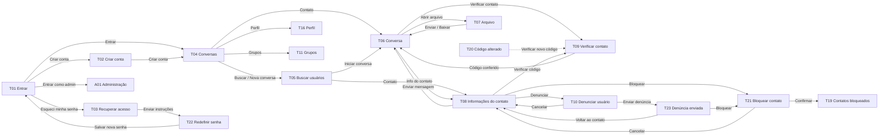
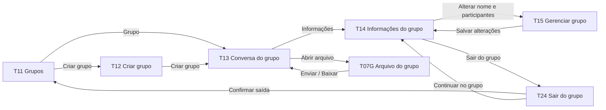
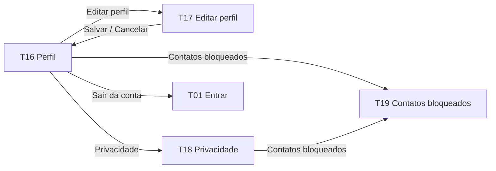
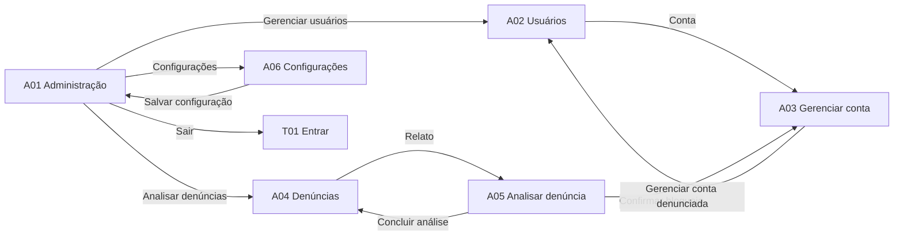

# Fluxo das telas — DirectChannel

Mapa de navegação validado na issue [#3 — P03 Validar mapa de navegação](https://github.com/JonathanBufon/directchannel/issues/3)
(responsável: Jaider Marquina · revisor: Jonathan Bufon). Wireframes e protótipo completos no
[documento UX/UI](directchannel-projeto-ux-ui.pdf).

## Índice de telas

### Usuário (T01–T24)

| Tela | Nome | Grupo de fluxo |
|---|---|---|
| T01 | Entrar | Acesso |
| T02 | Criar conta | Acesso |
| T03 | Recuperar acesso | Acesso |
| T04 | Conversas | Conversas |
| T05 | Buscar usuários | Conversas |
| T06 | Conversa (ex.: *Marina Costa*) | Conversas |
| T07 | Arquivo | Arquivos |
| T07G | Arquivo do grupo | Arquivos |
| T08 | Informações do contato | Contato |
| T09 | Verificar contato | Contato |
| T10 | Denunciar usuário | Contato |
| T11 | Grupos | Grupos |
| T12 | Criar grupo | Grupos |
| T13 | Conversa do grupo (ex.: *Equipe do projeto*) | Grupos |
| T14 | Informações do grupo | Grupos |
| T15 | Gerenciar grupo | Grupos |
| T16 | Perfil | Perfil |
| T17 | Editar perfil | Perfil |
| T18 | Privacidade | Perfil |
| T19 | Contatos bloqueados | Perfil |
| T20 | Código alterado | Contato |
| T21 | Bloquear contato | Contato |
| T22 | Redefinir senha | Acesso |
| T23 | Denúncia enviada | Contato |
| T24 | Sair do grupo | Grupos |

### Administração (A01–A06)

| Tela | Nome |
|---|---|
| A01 | Administração (painel) |
| A02 | Usuários |
| A03 | Gerenciar conta |
| A04 | Denúncias |
| A05 | Analisar denúncia |
| A06 | Configurações |

## Fluxos principais

| Fluxo | Caminho |
|---|---|
| Acesso e conversa | T01 → T04 → T05 → T06 → T07 |
| Recuperação de senha | T01 → T03 → T22 → T01 |
| Confiança no contato | T06 → T09 → T20 → T09 |
| Bloqueio e denúncia | T08 → T21 → T19 · T08 → T10 → T23 |
| Grupos | T11 → T12 → T13 → T14 → T15 / T24 |
| Perfil | T16 → T17 / T18 / T19 |
| Administração | A01 → A02 → A03 · A01 → A04 → A05 |

## Diagramas

### Acesso, conversas e contato

### Grupos

### Perfil

### Administração

> O administrador não acessa conteúdo de mensagens, anexos ou histórico em nenhuma tela A01–A06.

## Pendências encontradas na validação

| Item | Situação registrada na P03 | Encaminhamento sugerido |
|---|---|---|
| T20 Código alterado | Mesma navegação da T09 e **sem entrada** a partir de outra tela | É um estado disparado pelo sistema quando o código do contato muda (fluxo T06 → T09 → T20 → T09); documentar o gatilho no protótipo |
| T17 → Cancelar | Registrado como destino “T6” | Provável retorno a **T16 Perfil**; confirmar no protótipo |
| T19 → Desbloquear | Registrado como destino “T09*” | Definir se desbloquear permanece em T19 ou abre T09 para nova verificação |
| T14 / T24 (líder) | Saída do único responsável não tem transferência | Ver proposta **RF28** em [REQUISITOS-AJUSTES.md](REQUISITOS-AJUSTES.md) |

## Status de implementação

| Tela | Status | Evidência |
|---|---|---|
| T01 Entrar | Implementada (validação, sessão persistente) | [IMPLEMENTACAO.md](IMPLEMENTACAO.md#persistência-e-credenciais) |
| T16 Perfil | Implementada (avatar, cofre, GPS, notificação, logout) | [IMPLEMENTACAO.md](IMPLEMENTACAO.md#recursos-nativos) |
| Demais telas | Planejadas | [CRUDS.md](CRUDS.md) |
