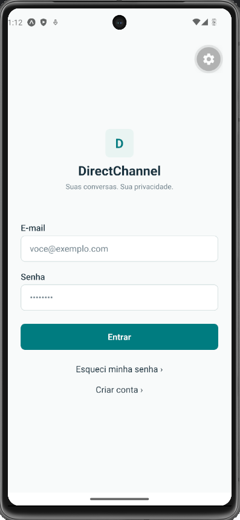
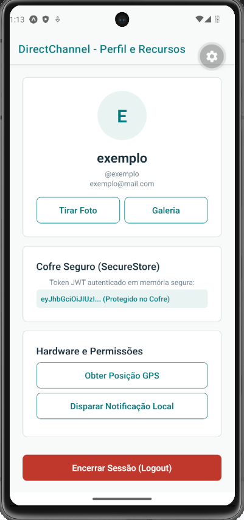
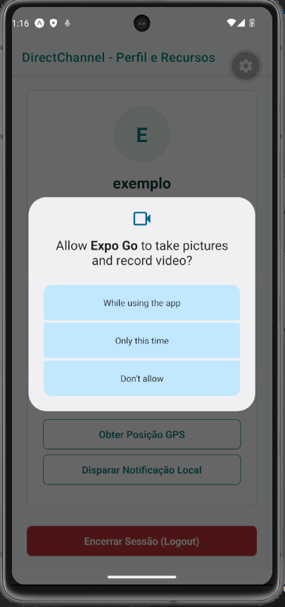
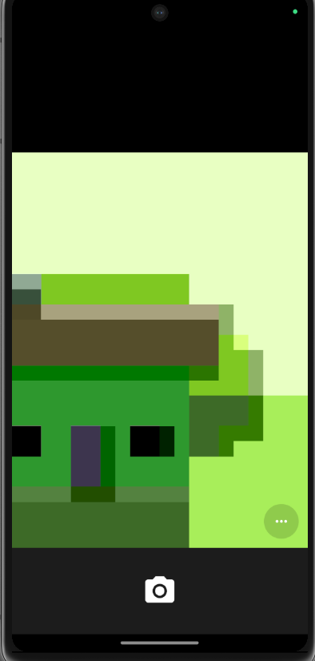
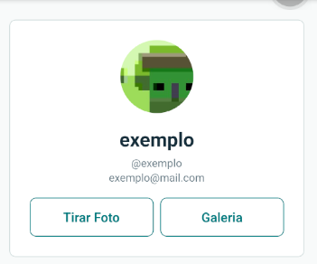
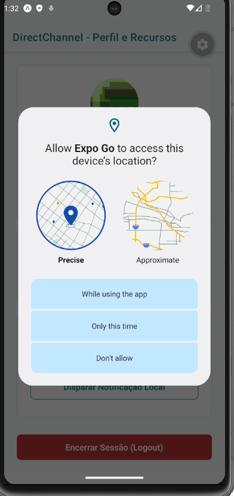
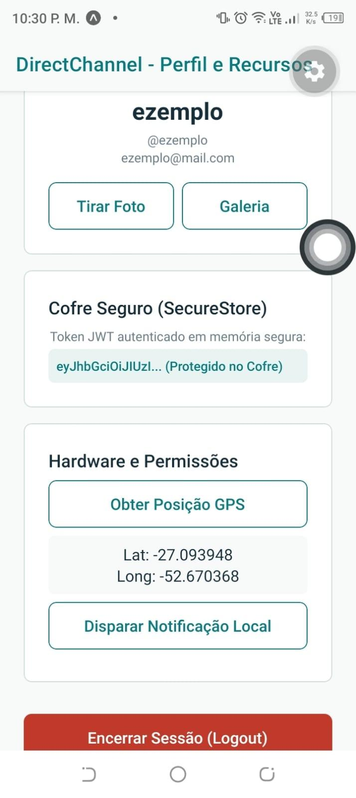
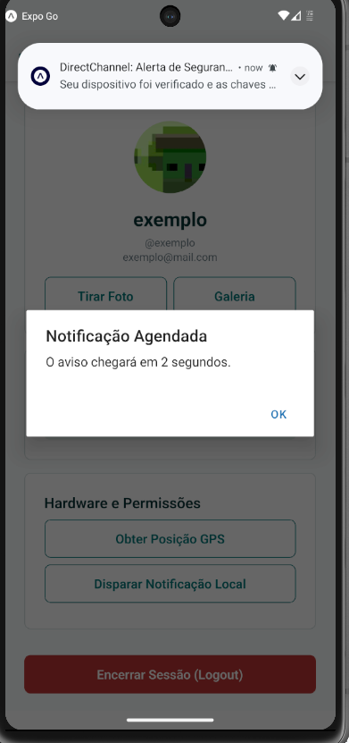

# Implementação e evidências — mobile

Resumo do [relatório técnico de implementação e evidências](relatorio-tecnico-implementacao.pdf)
(Turma AX — Jonathan Bufon, Rafael Merisio Neto, Jaider Armando Marquina Miranda).

## Arquitetura

App em **React Native + Expo (TypeScript)** com Atomic Design e separação estrita entre interface e hardware.

| Camada | Arquivos |
|---|---|
| Átomos | `Button`, `Input`, `Label` — [`mobile/src/components/atoms`](../mobile/src/components/atoms) |
| Moléculas | `FormField`, `ErrorMessage` — [`mobile/src/components/molecules`](../mobile/src/components/molecules) |
| Organismos / Template | `LoginForm`, `CenteredTemplate` |
| Telas | `LoginScreen` (T01), `ProfileScreen` (T16) — [`mobile/src/screens`](../mobile/src/screens) |
| Serviços (sem JSX) | [`storage.ts`](../mobile/src/services/storage.ts) — persistência · [`natives.ts`](../mobile/src/services/natives.ts) — hardware e permissões |

## Persistência e credenciais

Padrão das **duas gavetas** em [`storage.ts`](../mobile/src/services/storage.ts):

| Gaveta | Biblioteca | Conteúdo |
|---|---|---|
| Cofre seguro | `expo-secure-store` | Apenas o token de autenticação (`directchannel_auth_token`), com `WHEN_UNLOCKED_THIS_DEVICE_ONLY`. Nenhuma senha em texto claro. |
| Armazenamento comum | `@react-native-async-storage/async-storage` | Perfil público (`name`, `username`, `email`, `avatarUri`) e preferências (`directchannel_pref_*`) |

- **Sessão persistente:** ao abrir o app, a `LoginScreen` consulta o cofre; com token válido, navega direto para a área principal (`navigation.replace('Main')`).
- **Logout atômico:** `clearUserSession()` limpa cofre e perfil em paralelo (`Promise.all`) e remove a rota privada do histórico.

| T01 — Login validado | T16 — Cofre seguro em ação |
|---|---|
|  |  |

## Recursos nativos

Centralizados em [`natives.ts`](../mobile/src/services/natives.ts), sempre com permissão solicitada em tempo de execução.

### Câmera e galeria

- **Biblioteca:** `expo-image-picker` — `capturePhoto()` e `pickImageFromGallery()`.
- Solicita `requestCameraPermissionsAsync()` / `requestMediaLibraryPermissionsAsync()`, recorta em 1:1, grava a URI no AsyncStorage e atualiza o avatar.

| Permissão | Captura | Avatar persistido |
|---|---|---|
|  |  |  |

### Geolocalização (GPS)

- **Biblioteca:** `expo-location` — `getCurrentCoordinates()`.
- Permissão em primeiro plano (`requestForegroundPermissionsAsync()`); precisão balanceada, sem travar a interface.

| Permissão | Coordenadas exibidas |
|---|---|
|  |  |

### Notificações locais

- **Biblioteca:** `expo-notifications` — `setupNotificationHandler()`, `requestNotificationPermission()` e `sendLocalNotification()`.
- Exibe banner e som mesmo com o app em primeiro plano; a notificação é agendada com atraso de 2 s.

## Próximos passos

- Conectar o login à API Laravel (`backend/`) com tokens Sanctum — contratos em [CRUDS.md](CRUDS.md).
- Implementar as demais telas seguindo o [fluxo de telas](FLUXO-TELAS.md).
