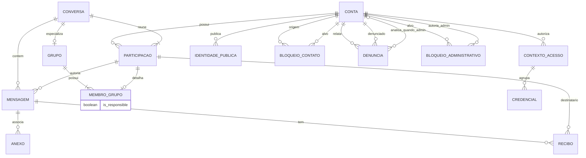

# Modelo conceitual e lógico — proposta para revisão

**Estado**: candidato, não aplicado; gate de fechamento físico em ERROR conforme [research.md](research.md). **SGBD alvo**: PostgreSQL 17 existente. Dicionário e regras físicas em [physical-model.md](physical-model.md); rastreabilidade em [traceability.md](traceability.md).

## 1. Vocabulário e decisões aprovadas

- **Conta**: usuário persistente, independente do perfil simulado no aparelho.
- **Participação**: ocorrência temporal de vínculo de uma conta com uma conversa; reentrada gera outra ocorrência.
- **Grupo**: contexto de conversa de grupo com nome, membros e responsáveis. A extensão grupo/conversa é uma convenção técnica candidata já admitida na arquitetura documentada.
- **Autorização de acesso**: contexto lógico de um dispositivo autorizado, não um inventário físico do aparelho e não um token único. Conta tem 0..1 contexto ativo, potencialmente várias credenciais nesse contexto.
- **Anexo**: registro de arquivo privado associado a uma mensagem; mensagem tem 0..N anexos.
- **Decisão administrativa**: dado da moderação, sem encaminhamento de conteúdo privado. Limite de anexos/retenção de logs são somente consulta nesta fase.

As respostas aprovadas em `spec.md`, tanto da rodada anterior quanto da nova, são vinculantes no seu alcance explícito. Relações adicionais desenhadas abaixo são alternativas técnicas de implementação do mesmo domínio, a aprovar; cada P-01–P-09 só se fecha quando todas as suas subdecisões estiverem resolvidas.

## 2. DER conceitual Mermaid

O diagrama mostra relações de negócio do modelo candidato, não as oito tabelas operacionais do framework. `CONTEXTO_ACESSO` pode existir historicamente N vezes, mas somente um fica ativo por conta. Responsabilidade é o atributo booleano `MEMBRO_GRUPO.is_responsible`, correspondente a `group_members.is_responsible`, não uma entidade ou relação separada. Histórico de revisões de decisão administrativa ou de cargos não é aprovado pelo diagrama.

**Limites que o símbolo Mermaid não expressa sozinho**:

1. Conversa individual tem exatamente duas contas distintas; não há unicidade de par aprovada. Conversa de grupo tem exatamente um grupo na convenção candidata; uma conversa individual não pode ter grupo.
2. Conta ↔ conversa e conta ↔ grupo são N:N. No máximo uma participação aberta por conta/contexto; períodos encerrados são mantidos conforme política ainda a aprovar.
3. `GRUPO` ativo deve ter pelo menos um responsável ativo e pode ter vários simultaneamente, sem máximo específico (P-02 aprovado nesse alcance). Transferência é exigida na saída somente do último responsável. Cardinalidades de grupos desativados dependem da política de ciclo de vida.
4. Cada mensagem tem um autor participante válido; período de autoria e destinatários elegíveis exigem validação temporal. Não basta ser participante hoje.
5. Anexo final tem exatamente uma mensagem. Aprovado em P-03: upload privado antes da mensagem e associação final ao confirmar envio; arquivo temporário indisponível aos destinatários. Representação física da fase temporária continua pendente, não desenhada como entidade aprovada.
6. Material público e quantidade de chaves dependem do protocolo P-07; não existe entidade de chave privada no servidor.
7. Autoria de análise em denúncia é opcional antes da conclusão, não um analista obrigatório no cadastro. Aprovado em P-06: após conclusão, uma única decisão final com administrador/instante, sem reabertura/substituição no MVP; arquivamento preserva esses dados. Essa restrição adicional não é expressa somente pela cardinalidade Mermaid.

## 3. Modelo lógico relacional candidato

`PK` = chave primária, `FK` = chave estrangeira planejada, `UQ` = unicidade. Campos/tabelas de pacote ou de regra pendente são candidatos, não contrato público. Tipos e nulabilidade completos estão no dicionário físico.

| Relação | Chave e atributos | Papel / dependências |
| --- | --- | --- |
| `users` (existente, extensão proposta) | PK `id`; atuais `name,email,password,email_verified_at,remember_token,created_at,updated_at`; novos `username,is_admin,deleted_at` | `id` determina dados da conta; e-mail único preservado. Username único sem distinção de caixa inclui contas desativadas; comparação internacional, alteração e backfill seguem P-01 |
| `access_grants` | PK `id`; FK `user_id`; `started_at,revoked_at` | Uma ocorrência de autorização de contexto; UQ parcial por usuário ativo, sem limitar tokens |
| `personal_access_tokens` (pacote planejado) | PK `id`; vínculo polimórfico `tokenable_type,tokenable_id`; `name,token,abilities,last_used_at,expires_at,created_at,updated_at` | Esquema de referência do Sanctum, a confirmar na versão de #13. Não declara FK da relação polimórfica como se já existisse |
| `access_grant_tokens` | PK/FK `personal_access_token_id`; FK `access_grant_id` | Associação de várias credenciais a uma autorização; conta do token precisa coincidir com a da autorização |
| `conversations` | PK `id`; `kind,created_at` | Contexto `direct` ou `group` como códigos físicos candidatos, sem alterar payload público |
| `conversation_participants` | PK `id`; FK `conversation_id,user_id`; `joined_at,left_at` | Relação N:N temporal; UQ parcial do par aberto e UQ técnica `(id,conversation_id)` para FK composta |
| `groups` | PK `id`; FK/UQ `conversation_id`; `name` | Extensão 1:1 de conversa de grupo; desativação/eliminação fica P-02/P-08, sem inventar campo de ciclo final |
| `group_members` | PK/FK `participant_id`; FK `group_id`; `is_responsible` | Associação conta–grupo via participação canônica; não repete conta/datas. Mesmo contexto; vários responsáveis sem máximo específico, com pelo menos um ativo por grupo ativo |
| `messages` | PK `id`; FK `conversation_id`; FK composta `(sender_participant_id,conversation_id)`; `encrypted_body,accepted_at` | Autor deriva da participação; conversa repetida para histórico indexável, exceção controlada explicada abaixo |
| `message_receipts` | PK composta/FKs `message_id,recipient_participant_id`; `delivered_at,read_at` | Relação N:N entre mensagem e ocorrência destinatária, com unicidade do recibo desse par |
| `attachments` | PK `id`; FK `message_id`; `storage_key,size_bytes` | Mensagem 1:N anexos finais; contexto/autor derivam de mensagem. Upload privado anterior e associação ao confirmar envio aprovados; representação temporária/limpeza seguem P-03, integridade P-07 |
| `blocks` | PK composta/FKs `blocker_user_id,blocked_user_id` | Relação direcionada atual; excluir vínculo significa desbloquear, sem exigir histórico não aprovado |
| `reports` | PK `id`; FKs `reporter_user_id,reported_user_id,reviewer_user_id`; `reason,narrative,status,decision,decided_at,created_at,deleted_at` | Denúncia com uma decisão final, administrador/instante; sem reabertura/substituição no MVP. Estados/transições/permissões ainda P-06 |
| `account_blocks` | PK `id`; FKs `user_id,blocked_by_user_id,unblocked_by_user_id`; `reason,blocked_at,unblocked_at` | Registro de bloqueio e seu encerramento; estado corrente derivado de ocorrência aberta, não replicado em `users`. Impede novos logins, sem revogar contexto/credenciais já emitidos |
| `public_key_material` | PK `id`; FK `user_id`; `public_payload,published_at` | Posição candidata para material público, não schema de protocolo completo; P-07 bloqueia composição/versionamento |

São **14 relações novas candidatas** e extensão de `users`; as sete outras tabelas existentes permanecem intocadas. `migrations` é controle do framework, não tabela de negócio adicional. Nenhuma relação de configuração, GPS, avatar remoto, notificações locais, preferência sincronizada, histórico duplicado ou chave privada foi criada por inferência.

As 14 incluem **13 relações de domínio/associação e uma única `personal_access_tokens` de propriedade do Sanctum**. A referência lógica não autoriza uma migration manual adicional à oficial do pacote. As migrations atuais não declaram essa tabela; sua ausência no banco em execução não foi comprovada. Grants/ponte não repetem o digest do token e não substituem a tabela oficial.

**Campos deliberadamente não fechados**: arquivamento/saída individual em P-05; ciclo de exclusão de grupo em P-02; remoção/metadados de anexo em P-03/P-09; demais atributos de protocolo em P-07. Não apresentar uma tabela incompleta nesses domínios como CRUD completo implementável.

## 4. Normalização até a 3FN

**1FN**: membros, destinatários, anexos e credenciais são linhas próprias, não colunas `anexo1/anexo2`, arrays de IDs ou texto separado por vírgula. Payload cifrado e material público do protocolo são valores opacos de uma responsabilidade externa, não listas relacionais de membros.

**2FN**: em `blocks` o par inteiro identifica o vínculo; não há atributo dependente de apenas um lado. Em `message_receipts`, entrega/leitura dependem do par mensagem/destinatário, não do nome/e-mail do destinatário. A ponte `access_grant_tokens` identifica uma credencial em um contexto sem copiar os dados da conta.

**3FN por grupos de dependência**:

- Conta: identidade determina atributos; nomes/e-mails não são copiados para mensagens, participações, grupos ou denúncias. Estado de bloqueio deriva de `account_blocks`, evitando redundância em `users`.
- Conversa: tipo pertence à conversa; nome de grupo pertence à extensão; grupo e participante não guardam listas de membros. `group_members.participant_id` determina seu grupo e papel; o grupo não determina o papel individual. O contexto repetido entre relações precisa do invariante de coerência, não de segunda lista de participantes.
- Participação: período pertence à ocorrência, não ao usuário isolado. Responsabilidade atual é atributo do membro, sem impor histórico adicional de cargos.
- Anexo: `id → message_id,storage_key,size_bytes`; conversa é derivada da mensagem, não repetida. Referência de arquivo não é chave de reutilização entre mensagens.
- Denúncia: campos descrevem relato e uma decisão final com autoria/instante; não replica perfil nem conversa. Reabertura/revisões excluídas do MVP por aprovação local; não há relação adicional de decisões. Imutabilidade após conclusão é invariante de escrita, não consequência da 3FN.
- Credencial: contexto de autorização separado de usuário e token, permitindo várias credenciais sem copiar status do contexto em cada uma.

**Exceção nova, explícita e sujeita a aprovação**: `messages` conserva `conversation_id`, embora `sender_participant_id → conversation_id`. Portanto, a relação não está estritamente em 3FN. Motivo: histórico/paginação exigidos por #17 podem usar índice direto por conversa; FK composta garante que o valor repetido não diverge da ocorrência de autoria. Alternativa integralmente em 3FN é remover `messages.conversation_id` e recuperar conversa por join com participação; não existe medição que imponha a exceção. Revisão deve escolher uma das duas antes de migration; todos os artefatos desta proposta usam a exceção de forma consistente.

**Recomendação desta revisão, não aprovação**: manter a variante candidata com redundância controlada para o acesso dominante por conversa. A dependência de conversa pelo autor é transitiva a partir de `messages.id`; o índice histórico global da conversa evita reunir e ordenar mensagens de várias ocorrências de participação. Em contrapartida, há custo de armazenamento/escrita em coluna, índices e UQ técnica na participação, além de acoplamento à FK composta. A variante estrita usa FK simples de autoria e índice candidato `(sender_participant_id,accepted_at,id)`, com join e eventual ordenação global por conversa; não é necessariamente lenta. Comparar ambas futuramente com mesma volumetria, distribuição de grupos, retenção e paginação por cursor, medindo latência, planos e custo de escrita em ambiente autorizado. Sem benchmark, o ganho é hipótese. Se a variante estrita for aprovada, remover coluna/FK direta de conversa, FK composta e seus índices específicos de mensagens, revisar a UQ técnica da participação e atualizar físico/rastreabilidade juntos; nada disso é executado agora.

**Exceções herdadas preservadas**: payloads de `sessions`, cache e filas e a relação polimórfica padrão de tokens não são remodelados para “normalização global”. A tabela do pacote não oferece FK SQL por si; a ponte e a validação de coerência são necessárias. Não certificar 3FN de conteúdo serializado desconhecido nem mudar o esquema do framework.

## 5. Ciclos de vida conhecidos e limites

| Conceito | Transição fundamentada | Não inferir |
| --- | --- | --- |
| Conta | ativa → desativada logicamente por operação autorizada; identificador público continua reservado, sem reutilização por outra conta | Restauração, alteração/destino de nomes anteriores, política de e-mail, purga ou cancelamento em cascata |
| Autorização | vigente → revogada; novo login autorizado substitui o contexto anterior | Uma única credencial, fingerprint do aparelho ou transferência de chaves privadas |
| Participação | entrada → encerramento; reentrada cria outra ocorrência | Acesso automático a todos os períodos anteriores ou apagamento de cópias recebidas |
| Responsabilidade | vários responsáveis sem máximo específico; pelo menos um ativo; transferência escolhida/confirmada na saída do último | UQ de responsável por grupo, promoção automática ou histórico de cargos obrigatório |
| Mensagem | aceitação/envio → entrega e leitura apenas se habilitada | Editar/excluir texto no MVP ou telemetria de leitura desativada |
| Anexo | upload privado antes da mensagem → associação final ao confirmar envio; temporário indisponível aos destinatários; remoção prevista por #19 | Representação física de temporários, limpeza/prazo, limites, falhas parciais e descarte aprovados |
| Denúncia | criação → análise → uma decisão final sem reabertura/substituição → arquivamento lógico preservando decisão/autoria/instante | Enum/transições não definidos, edição por denunciante, histórico de revisões ou descarte físico |
| Bloqueio de contato | criação do par → remoção do par ao desbloquear | Históricos de tentativas, bloqueio recíproco ou efeito automático em grupos |
| Bloqueio administrativo | bloqueio com autoria/motivo → impedir novos logins; acesso por credenciais anteriores continua até logout/expiração → desbloqueio com autoria | Não revogar contexto/tokens por consequência do bloqueio; renovação/reemissão segue P-04; não equiparar bloqueio a desativação lógica |

## 6. Invariantes fora de CHECK/FK simples

Exatamente duas pessoas na conversa individual; contexto de grupo correto; responsabilidade ativa no mesmo grupo; transferência sem grupo sem responsável; autoria/destinatário no período permitido; coerência dos donos de credencial; não sobreposição de períodos e revogação concorrente são invariantes de escrita coordenada futura. O modelo físico distingue quais partes ficam em índice/FK e quais requerem transação. Não atribuir a um CHECK com subconsulta uma garantia que PostgreSQL não fornece, nem afirmar que FK protege mensagens sem E2EE.

## 7. Revisão de compatibilidade lógica/física e gate

O modelo relacional não precisa de `created_at`/`updated_at` em todas as relações para ser válido. Contudo, Eloquent pressupõe esse par e uma PK simples `id` gerada, salvo configuração explícita. As seções 1.1/1.2 de [physical-model.md](physical-model.md) corrigem as lacunas documentais: gestão de timestamps por tabela, casts e precisão/fuso de datas de domínio, PK compartilhada sem geração própria e acesso por par completo às PKs compostas. Não adicionar colunas ou trocar PK apenas para seguir inferências do ORM. `deleted_at` não implementa exclusão lógica sozinho; tipos `bytea` não implementam E2EE sozinhos.

| Verificação | Resultado e classificação dos problemas |
| --- | --- |
| Tipos, tabelas e infraestrutura | Compatibilidade estática com PostgreSQL 17/migrations declaradas, sem erro de tipo comprovado; preservadas oito tabelas atuais e conexão/volume existentes |
| Datas e identidade Eloquent | **Erro técnico comprovado (lacuna documental)**: faltava explicitar a incompatibilidade com automação padrão de timestamps e identidade composta. Documentado mapeamento futuro, sem implementação nem alteração de campos |
| PK/FK/índices/constraints | **Erro técnico comprovado (terminologia)**: “PK parcial” no físico corrigida para componente NN da PK composta. FK composta e UQ integral coerentes; revisão de redundância de índices/FK direta é **melhoria opcional**, não correção obrigatória |
| Duplicação de tokens | Nenhuma duplicação nas migrations declaradas; uma única tabela oficial candidata, versão/integração ainda P-04 |
| Grupo/conversa/participação | Uma fonte de mensagens e períodos. FK/UQ não garantem tipo/totalidade/coincidência de contextos. Invariantes de integridade são obrigatórias; mecanismo concorrente é escolha técnica a aprovar, sem novo domínio |
| `messages.conversation_id` | **Melhoria opcional**, com aprovação técnica da variante pendente: manter exceção controlada candidata conforme seção 4 ou migrar o desenho integralmente para derivação por join; sem promessa de desempenho |
| E2EE, anexos e moderação | **Decisão de negócio pendente**, com validação técnica/segurança: P-03/P-06/P-07/P-09 impedem tratar tabelas mínimas como esquema concluído; não completar protocolo/estados por suposição |

A análise classificada completa e as condições de desbloqueio de **cada P-01–P-09** estão em `physical-model.md`, seção 10. P-01 fecha identidade/backfill; P-02 ciclo de grupos/reentrada; P-03 ciclo de arquivo/associação; P-04 troca/renovação e versão Sanctum; P-05 arquivamento/efeitos de bloqueio; P-06 estados/revisões; P-07 protocolo/material público; P-08 retenção/capacidade; P-09 metadados/corpo/eventos. As cinco respostas aprovadas em `spec.md` permanecem vinculantes, não reabertas.

**Prontidão**: ainda **não pronto para `/speckit.tasks` de implementação integral**. Resolver pendências que afetam o esquema, aprovar R-02/R-03/R-04 e o mapeamento Eloquent, reconciliar os artefatos e reavaliar o gate antes de gerar tarefas. Melhorias opcionais não exigem otimização antecipada, mas não eliminam os bloqueios de negócio/protocolo. A revisão técnica anterior alterou somente os dois modelos; a nova rodada sincroniza também especificação e pesquisa no alcance de cada aprovação. Nenhuma tabela foi adicionada/removida; estruturas não fechadas continuam candidatas.

**Nova rodada de esclarecimentos — decisão 1**: P-05 parcialmente resolvido em `spec.md`: bloquear administrativamente impede apenas novos logins; contexto e credenciais anteriores continuam até logout ou expiração. O estado de bloqueio permanece em `account_blocks`, sem booleano duplicado ou nova relação. Coordenação de novo login/bloqueio é obrigatória, mas não deve revogar grants/tokens existentes. Demais permissões e regra de um dispositivo ativo continuam válidas. Arquivamento/saída, desativação e renovação/reemissão permanecem pendentes; a aprovação parcial não torna o modelo pronto para implementação.

**Nova rodada de esclarecimentos — decisão 2**: P-03 parcialmente resolvido: upload privado anterior à mensagem, associação final ao confirmar envio e temporários indisponíveis aos destinatários. A relação `attachments` descrita acima continua sendo a associação final 1:N; decidir depois se SQL também representa temporários ou se a linha só nasce na associação final. Sem aprovar automaticamente `message_id` anulável, tabela de staging, estado extra ou nova rota; limpeza, falhas, limites e remoção continuam pendentes.

**Nova rodada de esclarecimentos — decisão 3**: P-01 parcialmente resolvido: identificador permanece reservado após desativação, incluindo variantes de caixa. A unicidade candidata de `users.username` inclui linhas com `deleted_at` preenchido; não usar índice apenas de contas ativas. Não há nova relação de reserva proposta. Alteração/nome anterior, comparação internacional e backfill continuam pendentes; eventual purga precisa preservar a política aprovada conforme P-08.

**Nova rodada de esclarecimentos — decisão 4**: P-06 parcialmente resolvido: uma única decisão final por denúncia, com administrador/instante na própria `reports`; sem reabertura/substituição após conclusão no MVP. Arquivamento preserva esses atributos. Não criar relação de revisões nem pressupor estados: lista/transições/permissões continuam pendentes. Concorrência e mutações devem proteger a decisão final de sobrescrita.

**Nova rodada de esclarecimentos — decisão 5 e encerramento**: P-02 parcialmente resolvido: vários responsáveis simultâneos, sem máximo específico, mantendo pelo menos um ativo em grupo ativo. `is_responsible` permanece atributo da participação detalhada; não adicionar UQ de responsável por grupo ou tabela de cargos. Transferência apenas na saída do último; histórico encerrado não conta. Ciclo final, atribuições fora da saída e acesso após reentrada continuam pendentes. Rodada encerrada com cinco respostas; pendências residuais P-01–P-09 continuam identificadas em `spec.md`/`research.md`, sem aprovação integral ou autorização de implementação.
